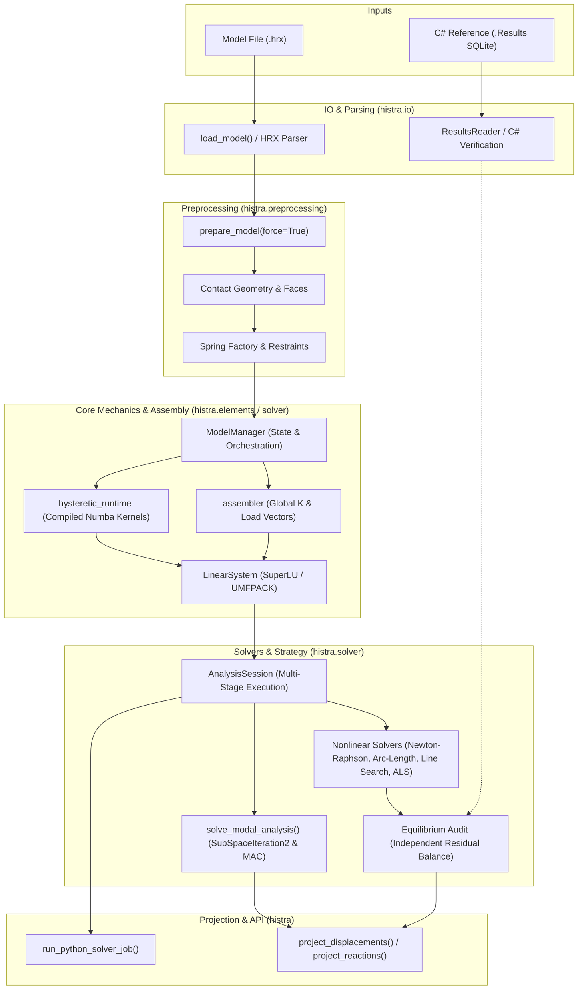
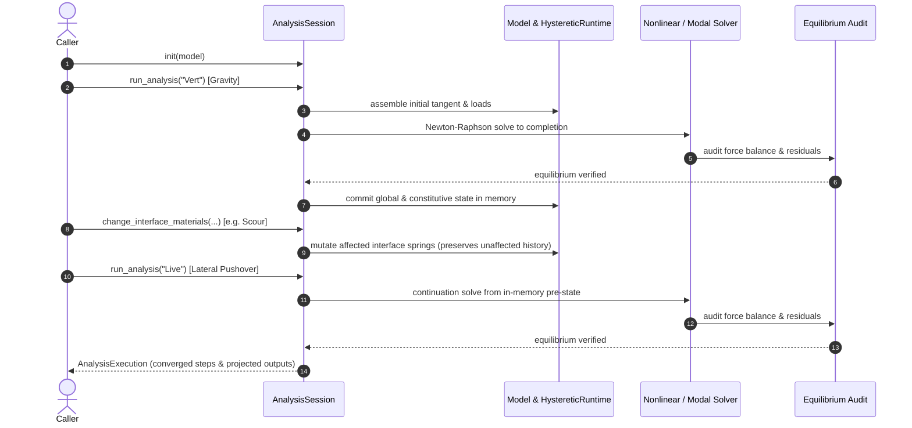

# histra-python

An installable, in-process Python implementation of the supported HiStrA
static nonlinear and modal-analysis workflows.

## Backend service API

```python
from histra import PythonAnalysisRequest, run_python_solver_job

result = run_python_solver_job(
    "model.hrx",
    [
        PythonAnalysisRequest(
            name="Vert",
            output_request=outputs,
            timeout_seconds=600,
        )
    ],
    timeout_seconds=600,
)
```

The service:

- loads the HRX once;
- resolves and executes `InitialAnalysisKey` dependencies;
- keeps committed global and constitutive state in memory;
- applies concrete interface/material mutations between analyses;
- enforces job and analysis deadlines cooperatively;
- projects C#-compatible reaction and model-point displacement rows.
- executes `AnalysisType=5` modal analyses and projects C#-compatible modal
  summaries and complete global-DOF mode shapes.

## Install

```console
python -m pip install -e .
```

Runtime dependencies are NumPy, SciPy, and Numba, with Python 3.12 through 3.14
accepted by the package. Current local verification covers Windows x64 and
Ubuntu on Python 3.12; the CI workflow also targets Linux Python 3.13 and 3.14.
See [current status](docs/STATUS.md) for benchmark scope and
[the v1.6.0 preparation record](docs/release/v1.6.0-preparation.md) for artifacts
and platform evidence.

## Architecture & System Workflow

The following diagram illustrates the flow from source inputs through preprocessing, mechanics assembly, numerical solution, and output projection:



### Multi-Stage Stateful Analysis Chains

`AnalysisSession` coordinates chained multi-analysis runs, retaining committed element and constitutive state in memory across analysis boundaries:



## Public API

The stable root package exports:

- `load_model`
- `AnalysisSession`
- `run_python_solver_job`
- `PythonAnalysisRequest`
- `ConcreteInterfaceMutation`
- `AnalysisExecution`, `AnalysisStep`, `AnalysisOutcome`
- `solve_modal_analysis`, `ModalAnalysisResult`, `ModalMode`
- capability and cancellation exceptions
- `inspect_solver_strategy`, `SolverStrategyReport`, and
  `SuboptimalSolverStrategyWarning`
- `project_analysis_outputs`, `project_displacements`, `project_reactions`

## Output compatibility

`project_displacements` reproduces the fields selected by HiStrA Job Runner from
C# `DisplModelPoints`:

```text
IdElement, ParentKey, Step, Ux, Uy, Uz
```

For supported Node model points it averages connected Quad predictions like the
C# response operation. Quad model points use centroid or vertex displacement
according to `IdVertex`. The mapping and numerical values are regression-tested
against the included authoritative `model.hrx` + `model.Results` pair.

Reaction projection uses the C# `ReactionSumStates` sign convention:

```text
Step, R1, R2, R3
```

Static nonlinear solves independently audit global force balance and the full
active-DOF residual before every commit. Warning mode preserves the C# path;
strict mode rejects unsafe states. `run_python_solver_job` uses strict mode by
default. See
[nonlinear convergence and equilibrium safety](docs/nonlinear_convergence_safety.md).

## Solver strategy advice

The default strategy policy is `warn`. The advisor reports supported but
potentially unsafe or inefficient configurations through Python warnings and
`on_log`; it never changes an analysis definition. Recommendations are
scenario-qualified and must still pass the independent equilibrium and response
checks. See [nonlinear convergence and equilibrium safety](docs/nonlinear_convergence_safety.md).

## Batch modal C#/Python parity

A directory or wildcard can be used to validate many models against C# in one
command:

```console
python -m histra.tools.run_modal my_model\modal-tests\* --analysis 30
```

For each HRX, the runner automatically looks for a same-stem `.Results` file,
regenerates the computational springs with Python (even if C# already prepared
the HRX), runs the modal analysis, and compares every `ModalValues` quantity and
the corresponding `ModalShapeValues` using MAC. Consolidated JSON/CSV reports
are written under `<models-root>/modal-comparison`. Use
`--preprocessing stored` for a narrower eigensolver-only check.

## Current capability boundary

Supported backend scope is the static nonlinear and modal Quad/Interface masonry
subset. Capability preflight accepts validated P-Delta `EachStep` and
`EachIteration`, and rejects unknown solver/material enums, unsupported
model-point element types, broken analysis chains, dynamic analysis, and
response-spectrum contributions before solving. Modal eigenanalysis itself is
supported.

The modal solver ports the active C# consistent Quad mass integration,
`SubSpaceIteration2`, inverse iteration, mass normalization, participation
coefficients and effective modal masses. `histra.tools.run_modal` supports
single-model execution and batch C#/Python parity validation of folders or
wildcards, including all `ModalValues` and sign-invariant mode-shape MAC checks.
See [Modal analysis](docs/guides/modal-analysis.md).

The solver uses shared class-level runtime arrays internally, so one solve is
active per Python process. A cancellable process-wide lock prevents concurrent
state corruption. Cooperative cancellation checks are present at load-step,
Newton, line-search, ArcLength retry, and ALS boundaries. A single native
linear solve cannot be interrupted in the middle.

## C# numerical parity mode

The authoritative C# solver uses SuiteSparse UMFPACK. For branch-sensitive
parity regressions, select the same native backend explicitly with
`HISTRA_LINEAR_SOLVER=umfpack` and point `HISTRA_UMFPACK_LIBRARY` to the native
shared library. The default remains SciPy SuperLU to preserve existing production behavior.
Use `auto` only when environment-dependent backend selection is intentional; it
uses UMFPACK when available and otherwise falls back to SuperLU.

An optional deterministic JSONL/NPZ diagnostic stream records step and Newton
iteration metrics with stable C# spring identifiers. It is disabled by default.
See [C# parity diagnostics](docs/guides/csharp-parity-diagnostics.md) and the
[branch-divergence investigation](docs/investigations/csharp-python-branch-divergence.md).

## Tests

```console
pytest histra/tests
```

The normal suite includes a solve of the `Vert` benchmark and compares projected
rows with its authoritative C# `.Results` database. Longer chain and live-load
acceptance tests remain opt-in through their documented environment variables.
The Ersino modal regression is opt-in through `HISTRA_MODAL_HRX` and
`HISTRA_MODAL_RESULTS`.
