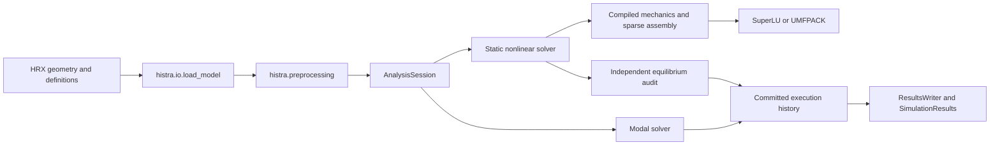

# Architecture and subsystem ownership

The public package exposes in-process analysis and result APIs. The numerical
implementation preserves the supported C# HiStrA routine behavior; named
benchmarks and native fixtures define the evidence boundary.

## Ownership

| Package/module | Responsibility |
|---|---|
| `histra.model` | Structural entities, collections, loads and analysis definitions |
| `histra.preprocessing` | Fresh geometry, contact topology, afference, restraints and spring definitions |
| `histra.elements`, `histra.springs` | Quad/interface mechanics and scalar constitutive reference objects |
| `histra.solver.hysteretic_runtime`, `hysteretic_kernels` | Dense compiled constitutive state and numerical kernels |
| `histra.solver.hysteretic_batch` | Compatibility facade re-exporting runtime/topology/kernel owners |
| `histra.solver.model_manager` | Runtime ownership, preparation and assembly facade |
| `histra.solver.session` | Dependency chains, committed-state handoff and analysis-boundary mutations |
| `histra.solver.solve`, `nonlinear_step` | Static solve setup, stepping, iteration and outcome handling |
| `histra.solver.modal` | Mass/eigenvalue analysis and modal output |
| `histra.solver.backend_api` | Job requests, deadlines, mutations and selected output projection |
| `histra.postprocessing`, `solver.output_projection` | Native-compatible physical translations, reactions and model-point rows |
| `histra.io.results_snapshot`, `results_writer`, `results_reader` | Stage snapshots, native tiered storage and consumer access |
| `histra.tools` | Installed analysis, comparison and benchmark commands |
| `tools/` | Checkout-only native-reference generation, diagnostics and profiling |

## Lifecycle boundaries

Serialized HRX interfaces and springs describe a past application state. They
are reference data, not a prepared Python runtime. A required fresh preparation
rebuilds computational objects from structural geometry before a solve.
See [preprocessing](../guides/preprocessing.md).

Production solves require compiled coverage, including after restarts, runtime
rebuilds and material changes. The scalar objects and compatibility facades
remain useful for differential tests and reference inspection; they are not a
silent production fallback.

A process-wide solve guard protects shared runtime arrays. Run independent
concurrent analyses in separate processes. Cancellation is checked at load-step,
Newton, line-search and retry boundaries.

A successful increment commits global and constitutive state. An analysis
boundary can transfer that state to an HRX successor and apply supported
interface-material mutations. The session captures export snapshots at that
boundary so exporting a predecessor does not read a successor's spring state.
See [analysis chains](../guides/analysis-chains.md).

Independent equilibrium checks distinguish authored convergence from verified
force balance. Strict policies reject unsafe candidate states before commit;
compatibility warnings preserve the authored path. See
[convergence safety](../nonlinear_convergence_safety.md).

## Outputs and compatibility

`AnalysisExecution` retains the initial state, committed steps, terminal outcome
and optional modal results. The backend API projects requested model-point and
reaction rows; `ResultsWriter` stores native summaries and dense fields.
`SimulationResults` reads NPZ/HDF5 files and session manifests. The
[native results reference](native-results-format.md) defines units and schemas.

Facade modules and documented root exports preserve callers when implementation
owners move. Changing a constitutive law or solver threshold requires separate
native differential evidence; repository cleanup does not alter those routines.
